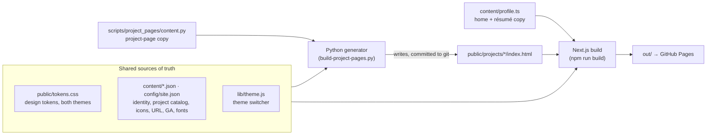
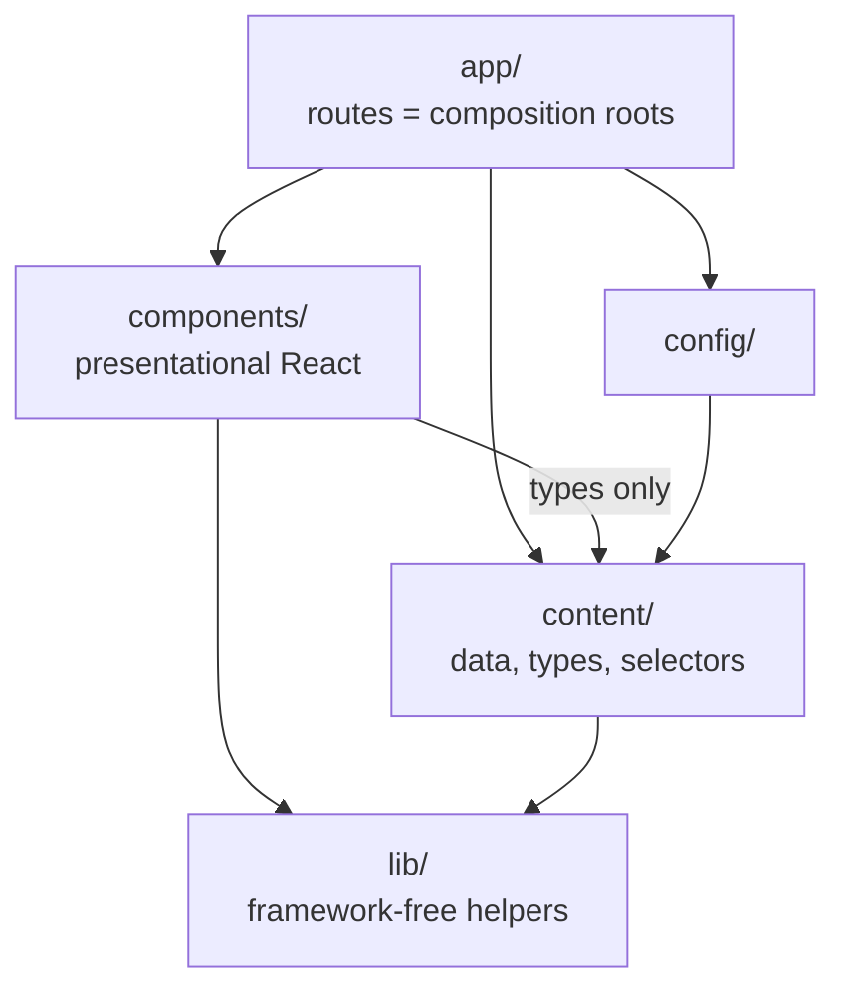

# Architecture

How the code is organised, and the rules that keep it that way. To change *what the site says*, you want [Editing content](editing-content.md) instead.

## Contents

- [The big picture](#the-big-picture)
- [Layers and dependency direction](#layers-and-dependency-direction)
- [The rules](#the-rules)
- [How a page is rendered](#how-a-page-is-rendered)
- [Client-side JavaScript](#client-side-javascript)
- [Directory map](#directory-map)
- [Extending the site](#extending-the-site)

---

## The big picture

The site has two kinds of page, produced by two tools, and they share their content and design through files both tools read.



- **The Next.js app** renders the home page (`/`), the résumé (`/resume/`) and the unlisted link-in-bio page (`/links/`) from `content/profile.ts`, then exports everything to static HTML in `out/`.
- **The Python generator** produces the seven project pages under `public/projects/`. Three are generated in full; four are R Markdown (knitr) reports that it enhances in place. Next copies `public/` into `out/` unchanged.
- **The shared files** (tokens, JSON, the theme script) are why both kinds of page have the same look, nav, theme switcher and facts, with nothing defined twice.

There is no server, database or runtime API: every page is static HTML ([decision D01](decisions.md#d01-static-export-to-github-pages)).

---

## Layers and dependency direction



Dependencies only point **down**:

| Layer | May import | Must not import |
|---|---|---|
| `app/` | anything | — |
| `components/` | other components, `lib/`, **types** from `content/types.ts`, constants from `content/sections.ts`, `content/selectors.ts` | content **data** (`content/profile.ts`) |
| `content/` | `lib/`, other `content/` | `components/`, `app/` |
| `lib/`, `config/` | `content/` (config only), each other | `components/`, `app/` |

Quick check that nothing points the wrong way (it should print nothing):

```bash
grep -rn "@/components" content lib config
grep -rn "@/content/profile" components
```

---

## The rules

These five rules are the project's interpretation of SOLID, DRY and SLAP. React uses **composition, not classes**: class components are React's legacy API, so the principles are applied by intent. The Python generator *is* object-oriented, because that's where classes pay for themselves ([decision D14](decisions.md#d14-react-uses-composition-the-generator-uses-classes)).

### Rule 1: One source per fact

If you're about to type a fact a second time, it already has a home:

| Fact | Single source | Read by |
|---|---|---|
| Home/résumé copy | `content/profile.ts` | Next |
| Name, role, employer, location | `content/identity.json` | Next, generator |
| Project pages: slug, title, teaser, order | `content/projects.json` | Next (cards, sitemap), generator |
| Project-page copy | `scripts/project_pages/content.py` | generator |
| Icon SVG paths | `content/icons.json` | Next, generator |
| URL, GA ID, fonts URL | `config/site.json` | Next, generator |
| Colours, type, spacing, both themes | `public/tokens.css` | every page; `theme-color` is *read* from `--bg` |
| Theme switching | `lib/theme.js` | inlined into every page |
| Section ids, nav labels, headings | `content/sections.ts` | Navbar, sections, proof tiles, sticky bar |
| Date-range format | `dateRange()` in `lib/format.ts` | every date range |
| "Is this link external?" | the URL itself (`lib/links.ts`, `model.Action.external`) | every link; there are no hand-set flags |

### Rule 2: Components receive data, they don't fetch it (dependency inversion)

Components import **types**; the route files in `app/` are the only places content data meets components:

```tsx
// app/(site)/page.tsx — the composition root
<Experience jobs={experience} />
```

Any component can then be rendered with any data (for a test, a preview, or a second page) without touching it.

### Rule 3: One level of abstraction per function (SLAP / single responsibility)

A component's main function reads like an outline. Markup details live in named sub-components underneath it, in the same file:

```tsx
function JobCard({ job }: { job: Job }) {
  return (
    <li className="job card">
      <JobHeader job={job} />
      {previousRoles(job).map((role) => <Promotion key={role.title} from={role} />)}
      <p className="job__summary">{job.summary}</p>
      <Bullets items={job.highlights} />
      <Chips items={job.stack} label="Tools used" />
    </li>
  );
}
```

Data shaping (tenure, contact channels, résumé entries) lives in `content/selectors.ts`, not in JSX. The same rule applies to the generator: `ReportPage._pipeline()` lists *what* happens to a report, and each `Transform` class holds *how*.

### Rule 4: Extend with data or new classes, not edits (open/closed)

- Adding a job, project, skill group, section, nav item or contact channel is a **data change**.
- What appears on the résumé is a **data flag** (`onResume`), not a hard-coded slice or label check.
- In the generator, new report behaviour is a new `Transform` or `ReportExtension`, registered in `site.py`. Never an `if slug == …` inside `ReportPage`.

### Rule 5: Narrow interfaces

Components take the smallest props that do the job (interface segregation): `Chips` takes `string[]`; `Hero` takes a `Pick<Profile, …>`; `Footer` takes three strings. Python protocols are equally small: a `Transform` has one method, `apply(src) -> src`.

---

## How a page is rendered

### Home page

1. `app/layout.tsx` renders `<html>`. Its `<head>` inlines `lib/theme.js`, so the saved theme applies before the body renders, along with the fonts link and JSON-LD built by `lib/seo.ts`. The `<body>` holds `Analytics` and the route.
2. `app/(site)/layout.tsx` wraps the home page and résumé in the site chrome: a skip link, `Navbar`, `<main>`, `Footer` and `MobileCta`. `(site)` is a route group, so it adds nothing to the URL.
3. `app/(site)/page.tsx` passes content into six sections: `Hero`, `Experience`, `Projects`, `Skills`, `Education` and `Contact`.
4. Each section wraps itself in `ui/Section`, which takes its id, label and heading from `content/sections.ts`.
5. `next build` prerenders it all to `out/index.html`.

### Résumé

`app/(site)/resume/page.tsx` composes the sections in `components/resume/ResumeSections.tsx`, using `resumeProjects()` and `resumeSkills()` from `content/selectors.ts` to decide what goes on paper. `@media print` in `app/globals.css` hides the site chrome.

### Link-in-bio page

`app/links/page.tsx` sits outside the `(site)` group, so it gets the root layout (theme, fonts, analytics) but no nav, footer or sticky bar. It renders `components/links/LinkInBio.tsx` with `linkInBioChannels()` from `content/selectors.ts`: website, Instagram, Facebook, LinkedIn, X, GitHub, WhatsApp, email. It is deliberately unlisted ([decision D19](decisions.md#d19-the-link-in-bio-page-is-unlisted)): nothing links to it, it isn't in the sitemap, and it carries `noindex, nofollow`.

### Project pages

See [Project pages](project-pages.md). In short: `site.py` builds a `HandPage` or `ReportPage` for each catalog entry, and `page.build()` renders it with the shared `Renderer` and writes it if it changed.

---

## Client-side JavaScript

The site is server-rendered HTML; JavaScript only adds behaviour.

| Code | Runs | Does |
|---|---|---|
| `lib/theme.js` | Inline in `<head>` on every page | Applies the saved theme; toggles it on click of any `[data-theme-toggle]` |
| `Navbar` (`'use client'`) | Home, résumé | Mobile menu open/close (and Escape key); border once scrolled |
| `MobileCta` (`'use client'`) | Home, résumé | Shows the sticky Résumé/Email bar between the hero and Contact on phones |
| `PrintButton` (`'use client'`) | Résumé | Calls `window.print()` |
| Google Analytics | Every page | Page-view analytics |
| knitr's bundled jQuery/DataTables | The three report pages | Interactive tables |

Nothing hides content until JavaScript runs ([decision D08](decisions.md#d08-no-scroll-triggered-reveal-animations)). With JavaScript off, every page still shows everything.

---

## Directory map

```
.github/workflows/deploy.yml     CI: check generated pages → build → deploy to GitHub Pages

app/
  layout.tsx                     <html>, <head> (theme script, fonts, JSON-LD), analytics
  (site)/                        Route group (no URL segment) for pages with site chrome
    layout.tsx                   Skip link, Navbar, <main>, Footer, MobileCta
    page.tsx                     Home page — composition root
    resume/page.tsx              Printable résumé — composition root
  links/page.tsx                 Unlisted link-in-bio page (Instagram bio), no chrome, noindex
  globals.css                    Component and print styles; @imports public/tokens.css
  robots.ts                      /robots.txt
  sitemap.ts                     /sitemap.xml — project URLs come from content/projects.json

components/
  ui/                            Primitives, no knowledge of the site's content
    ActionLink.tsx               Link styled as a button — every CTA
    SmartLink.tsx                <a> that opens external URLs in a new tab, safely
    Icon.tsx                     Inline SVG from content/icons.json
    Chips.tsx · Bullets.tsx      Tag list · bulleted list
    Logo.tsx                     Organisation logo on a white tile
    Section.tsx                  <section> + heading from a SectionDef (also exports SectionHeading)
  home/                          The home page's sections
    Hero.tsx                     Identity, headline, pitch, CTAs, proof tiles, core stack
    Experience.tsx               Job cards with promotion lines
    Projects.tsx                 FeaturedProjectCard.tsx + ProjectCard.tsx grid
    Skills.tsx · Education.tsx · Contact.tsx
  layout/                        Site chrome
    Navbar.tsx                   Top bar, mobile menu, ThemeToggle ('use client')
    ThemeToggle.tsx              Stateless sun/moon button; lib/theme.js does the work
    MobileCta.tsx                Sticky phone action bar ('use client')
    Footer.tsx · Analytics.tsx
  links/
    LinkInBio.tsx                Avatar, name, one large button per channel, theme toggle
  resume/
    ResumeSections.tsx           Résumé header, summary, experience, projects, education, skills
    PrintButton.tsx              "Save as PDF" ('use client')

content/
  types.ts                       Domain model (types only)
  profile.ts                     Home/résumé data
  selectors.ts                   Derived views: contact channels, link-in-bio links, tenure, résumé entries
  sections.ts                    Section definitions, nav items, anchor(), HERO_ACTIONS_ID, RESUME_HREF
  catalog.ts · projects.json     Project-page catalog (shared with the generator)
  icons.ts · icons.json          Icon set (shared with the generator)
  identity.json                  Name/role/employer/location (shared with the generator)

config/
  site.json                      URL, GA ID, fonts URL (shared with the generator)
  site.ts                        siteConfig: resolved URL, SEO strings, themeColor from tokens.css

lib/
  format.ts                      dateRange(), listSentence(), cx()
  links.ts                       isExternal(), externalAttrs(), waHref(), prettyUrl()
  seo.ts                         Metadata, viewport, JSON-LD
  theme.js                       The theme switcher (plain ES5, inlined everywhere)
  themeScript.ts                 Reads theme.js at build time for inlining

public/
  tokens.css                     Design tokens, both themes
  favicon.svg · .nojekyll        Icon · stops GitHub Pages running Jekyll over _next/
  images/                        Hero photo (WebP; PNG kept for social previews) and logos
  projects/
    site.css                     Shared project-page chrome (cd- prefixed)
    report.css                   Overrides for knitr / Bootstrap 3 / DataTables
    <slug>/index.html            Generated pages (don't hand-edit), plus images, datasets, .Rmd

scripts/
  build-project-pages.py         CLI entry point (build, or --check)
  project_pages/                 The generator package — see docs/project-pages.md

next.config.js                   output: 'export', trailingSlash: true
tailwind.config.ts               Preflight disabled (see decision D03)
```

---

## Extending the site

| Change | Where | Notes |
|---|---|---|
| New home-page section | Add to `content/sections.ts`, create `components/home/<Name>.tsx` using `ui/Section`, render it from `app/page.tsx` | The nav updates itself |
| New UI primitive | `components/ui/` | Keep it content-agnostic: props in, markup out |
| New derived value | `content/selectors.ts` | Not inline in a component |
| New colour or spacing value | `public/tokens.css`, in **both** theme blocks if it's a colour | See [Design system](design-system.md#adding-a-token) |
| New icon | `content/icons.json` (paths from `@fortawesome/fontawesome-free/svgs/`) | Usable from TSX and the generator |
| New project page | [Editing content → Add a project](editing-content.md#add-a-project) | |
| New report behaviour | A `Transform` or `ReportExtension` | [Project pages → Extending](project-pages.md#extending-the-generator) |
| New route | `app/(site)/<route>/page.tsx` for a page with nav and footer; `app/<route>/page.tsx` for a chromeless one | Static export only: no API routes or server actions ([D01](decisions.md#d01-static-export-to-github-pages)) |
