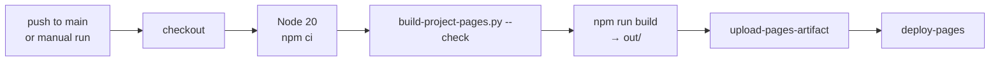

# Deployment

The site is hosted on **GitHub Pages** at <https://cooperdenny.github.io> and deployed by **GitHub Actions** on every push to `main`.

## Contents

- [The pipeline](#the-pipeline)
- [One-time repository settings](#one-time-repository-settings)
- [Deploying](#deploying)
- [Configuration](#configuration)
- [When a deploy fails](#when-a-deploy-fails)
- [Rolling back](#rolling-back)
- [After a deploy](#after-a-deploy)

---

## The pipeline

Defined in [`.github/workflows/deploy.yml`](../.github/workflows/deploy.yml):



| Step | Fails when |
|---|---|
| `npm ci` | `package-lock.json` is out of sync with `package.json` |
| `build-project-pages.py --check` | Committed project pages don't match their inputs ([why this exists](decisions.md#d15-generated-project-pages-are-committed-and-checked-in-ci)) |
| `npm run build` | Type errors, a broken import, an unknown project slug, or a missing `--band` token |
| `deploy-pages` | Pages isn't configured for GitHub Actions (see below), or a permissions problem |

**Triggers:** a push to `main`, or **Run workflow** on the Actions tab (`workflow_dispatch`).
**Concurrency:** one deploy at a time (group `pages`); a new push queues behind a running deploy instead of cancelling it.
**Permissions:** `contents: read`, `pages: write`, `id-token: write`, the minimum `deploy-pages` needs.

Pull requests don't deploy. They run [`.github/workflows/check.yml`](../.github/workflows/check.yml) instead: type-check, lint, `build-project-pages.py --check` and `npm run build` (the same four [pre-push checks](development.md#before-you-push)), with no deploy step and read-only permissions. A failing check shows on the PR before merge rather than as a failed deploy after it. Pushes to other branches without a PR trigger nothing.

## One-time repository settings

**Settings → Pages → Build and deployment → Source: GitHub Actions.**
With the classic "Deploy from a branch" source, the workflow's output is ignored.

`public/.nojekyll` must stay. Without it, GitHub Pages runs Jekyll over the output, which ignores folders starting with `_` and breaks Next's `/_next/` assets.

## Deploying

Merge or push to `main`. Watch the run on the **Actions** tab. It takes a couple of minutes, and the deploy job's summary links to the live site.

## Configuration

| Setting | Where | Default |
|---|---|---|
| Production URL | `config/site.json` → `url` | `https://cooperdenny.github.io` |
| Override the URL at build time | `NEXT_PUBLIC_SITE_URL` environment variable | unset (uses `site.json`). A malformed value falls back to `site.json`, so it can't break the build. |
| Google Analytics | `config/site.json` → `gaId` | `G-GPHTSF6Q5B` |

The URL is used for canonical links, Open Graph tags, the sitemap and JSON-LD. Normally you never need the environment variable.

`next.config.js` sets `output: 'export'` (static files only) and `trailingSlash: true`, so routes export as `<route>/index.html` and both `/cv` and `/cv/` work ([decision D16](decisions.md#d16-trailing-slashes-on-every-route)).

## When a deploy fails

1. Open the failed run on the **Actions** tab and find the red step.
2. Reproduce it locally with the matching command from [Before you push](development.md#before-you-push).
3. Fix, commit and push; the next push deploys.

The live site stays on the last successful deploy until a new one succeeds; a failed run never takes it down.

## Rolling back

```bash
git revert <bad-commit-sha>
git push origin main
```

That redeploys the previous state through the normal pipeline. Avoid force-pushing `main`.

## After a deploy

- [ ] The home page loads.
- [ ] `/cv/` loads and prints on two pages at most, and `/resume/` redirects to it.
- [ ] A project page loads (e.g. `/projects/afl-brownlow-2024/`), with its nav.
- [ ] Power BI embeds load on the two dashboard pages. They're third-party and can be slow.
- [ ] Optional: share the URL somewhere with link previews to check the Open Graph image and description.
