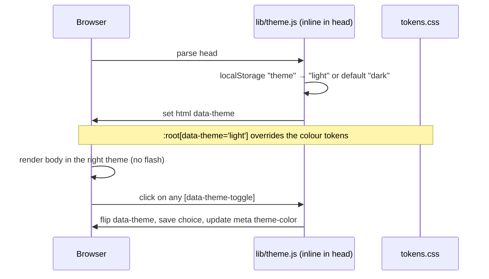

# Design system

Tokens, themes, layout rules, components and accessibility standards: everything you need to change how the site looks without breaking it.

## Contents

- [Principles](#principles)
- [Design tokens](#design-tokens)
- [Themes: light and dark](#themes-light-and-dark)
- [Layout and breakpoints](#layout-and-breakpoints)
- [Typography](#typography)
- [Components](#components)
- [Accessibility standards](#accessibility-standards)
- [Print](#print)
- [Stylesheets: what goes where](#stylesheets-what-goes-where)
- [Adding a token](#adding-a-token)

---

## Principles

1. **Tokens, not values.** Components never hard-code a colour, font or spacing value; they use a `var(--token)` from [`public/tokens.css`](../public/tokens.css). The deliberate exceptions are listed under [Themes](#deliberate-fixed-colours).
2. **Mobile first.** Base styles are for a phone; `min-width` media queries add the larger layouts.
3. **Evidence first.** Layout decisions serve one goal: a recruiter sees the important things before they leave ([decision D06](decisions.md#d06-the-home-page-is-designed-against-drop-off)).
4. **Accessible by default.** AA contrast in both themes, 44px touch targets, keyboard-operable, respects reduced motion.

---

## Design tokens

All tokens live in [`public/tokens.css`](../public/tokens.css) on `:root`. They're loaded by the Next.js app (`@import` at the top of `app/globals.css`) and by every project page (`<link href="/tokens.css">`), so the whole site has exactly one palette.

### Colour

| Token | Dark (default) | Light | Use |
|---|---|---|---|
| `--bg` | `#0b1120` | `#ffffff` | Page background |
| `--bg-alt` | `#0f172a` | `#f5f7fb` | Alternating section background |
| `--surface` | `#131c31` | `#ffffff` | Cards |
| `--surface-2` | `#1a2540` | `#f1f5f9` | Chips, metric tiles, raised areas inside cards |
| `--border` | `#23304d` | `#e2e8f0` | Default borders |
| `--border-strong` | `#2f3f63` | `#cbd5e1` | Ghost buttons, emphasised borders |
| `--text` | `#e8edf6` | `#0f172a` | Body text, headings |
| `--text-muted` | `#a3b0c5` | `#475569` | Secondary text |
| `--text-faint` | `#8090a8` | `#5f6f85` | Tertiary text: dates, captions, labels |
| `--accent` | `#22d3ee` | `#0e7490` | Links, primary buttons, highlights |
| `--accent-strong` | `#67e8f9` | `#155e75` | Primary button hover |
| `--accent-ink` | `#04222a` | `#ffffff` | Text on an `--accent` background |
| `--accent-soft` | `rgba(34, 211, 238, 0.12)` | `rgba(14, 116, 144, 0.08)` | Tinted backgrounds (badges, hero glow) |
| `--nav-bg` | `rgba(11, 17, 32, 0.86)` | `rgba(255, 255, 255, 0.9)` | Translucent sticky bars |
| `--code-bg` | `#070c18` | `#f8fafc` | Code blocks on report pages |
| `--shadow` | dark shadow | soft shadow | Card elevation |

### Type, shape and layout (same in both themes)

| Token | Value | Use |
|---|---|---|
| `--font-sans` | Inter, then system UI fonts | All text |
| `--font-mono` | JetBrains Mono, then system monospace | Labels, dates, metrics, code |
| `--radius` / `--radius-sm` | `14px` / `10px` | Cards / small elements |
| `--tap` | `44px` | Minimum touch-target size |
| `--container` | `1080px` | Max content width (home page) |
| `--gutter` | `16px` → `24px` at ≥ 600px | Horizontal page padding |
| `--nav-h` | `56px` → `64px` at ≥ 861px | Sticky nav height (also offsets anchor scrolling) |
| `--section-y` | `48px` → `64px` → `80px` | Vertical section padding |

Project pages add one local token, `--cd-wrap: 860px`, a narrower reading column defined in `public/projects/site.css`.

---

## Themes: light and dark

**Dark is the default.** A visitor can switch with the sun/moon button in the nav, and the choice is remembered in `localStorage` under the key `theme`.

### How it works

- **One implementation.** [`lib/theme.js`](../lib/theme.js) is inlined into `<head>` by `app/layout.tsx` (home, résumé, links) and by the generator's `Renderer.theme_script()` (project pages). Because it runs in `<head>`, the theme is set before the body renders, so there's no flash of the wrong theme.
- **Stateless buttons.** The toggle ([`ThemeToggle.tsx`](../components/layout/ThemeToggle.tsx), and the generator's `Renderer.theme_toggle()`) is a plain `<button data-theme-toggle>` containing both icons. The script handles clicks by event delegation, and CSS shows the sun in dark mode ("switch to light") and the moon in light mode. React never holds theme state, so server and client markup always match. `<html>` carries `suppressHydrationWarning` only because the script adds `data-theme` before React hydrates.
- **Browser chrome.** `<meta name="theme-color">` starts as the dark `--bg` (read from `tokens.css` at build time, never hard-coded) and the script updates it on every switch.
- **Storage blocked?** (Private mode, strict privacy settings.) The site falls back to dark and the switch still works for the visit; it just isn't remembered.

### Contrast

Every text colour meets **WCAG AA (≥ 4.5:1)** against every background it's used on, in both themes. The tightest pairs:

| Pair | Dark | Light |
|---|---|---|
| `--text-faint` on `--surface-2` | 4.68:1 | 4.68:1 |
| `--text-faint` on `--bg` | 5.80:1 | 5.12:1 |
| `--accent` on `--bg` | 10.42:1 | 5.36:1 |
| `--accent-ink` on `--accent` (buttons) | 9.17:1 | 5.36:1 |

If you change a colour, re-check it against `--bg`, `--bg-alt`, `--surface` and `--surface-2`, for example with the [WebAIM contrast checker](https://webaim.org/resources/contrastchecker/).

### Deliberate fixed colours

These ignore the theme on purpose:

| Element | Why |
|---|---|
| Logo tiles (`.job__logo`): white | Organisation logos are designed for light backgrounds |
| The résumé sheet (`.resume`): black on white | It's paper; it must print correctly and look like a document |
| Report plots (`.cd-report .section img`): white background | ggplot output has a white background baked in |

---

## Layout and breakpoints

| Breakpoint | Meaning | Typical changes |
|---|---|---|
| base (< 600px) | Phones | Single column, compact hero with a 64px avatar, 2×2 proof tiles, hamburger menu, sticky action bar |
| `min-width: 600px` | Large phones, small tablets | Wider gutters, two-column project grid, roomier cards |
| `min-width: 861px` | Desktop | Inline nav, large portrait, 4-up proof tiles, 3-column grid, sticky bar hidden |

One component-specific exception: on project pages, the nav's "Projects" label collapses to its arrow icon below 420px, so the nav fits a 320px screen.

Every layout must work from **320px to 1440px wide with no horizontal scroll**. That's checked as part of [verification](development.md#verifying-layout-and-themes).

---

## Typography

- **Inter** for all text and **JetBrains Mono** for labels, dates, metric values and code. Both come from Google Fonts via `<link>`; the URL is in `config/site.json` ([decision D05](decisions.md#d05-fonts-load-via-link-icons-are-inline-svg)).
- Headings use `text-wrap: balance`, and paragraphs `text-wrap: pretty`, to avoid orphans.
- **Code ligatures are off** in code blocks, so R's `<-` and `%>%` show as typed rather than as arrow glyphs.
- Small uppercase mono labels (`.eyebrow`, `.kicker`) introduce sections and cards.

---

## Components

Home-page and résumé styles live in `app/globals.css`, in BEM-style blocks (`.block__element--modifier`). The main building blocks:

| Class | Component | Notes |
|---|---|---|
| `.btn` + `--primary` / `--ghost` / `--small` / `--icon` | `ui/ActionLink` | Pill button, at least 44px tall; `--icon` is square |
| `.chips` / `.chip` (+ `--lg`) | `ui/Chips` | Tag lists |
| `.bullets` | `ui/Bullets` | Accent-square bullets |
| `.card` | — | Surface, border, radius, shadow |
| `.section` (+ `--alt`) | `ui/Section` | Alternate `--alt` between neighbouring sections |
| `.eyebrow`, `.kicker` | — | Mono uppercase labels |
| `.job__logo` (+ `--wide`) | `ui/Logo` | White logo tile |
| `.proof`, `.metrics`, `.disclosure` | Hero, FeaturedProjectCard | Proof tiles, metric tiles, `
` panel |
| `.project__link::after` | ProjectCard | Stretched link: the whole card is clickable |
| `.theme-toggle` | ThemeToggle | Sun/moon visibility is driven by `data-theme` |
| `.mobile-cta` (+ `--shown`) | MobileCta | Fixed bottom bar on phones; reserves `env(safe-area-inset-bottom)` |
| `.bio`, `.bio__link` | LinkInBio | `/links/`: 480px column, 64px-tall link buttons, safe-area padding for notched phones |

Project pages use the same vocabulary with a `cd-` prefix (`.cd-btn`, `.cd-chips`, `.cd-glance`, …), defined in `public/projects/site.css`. The prefix is needed because the R Markdown reports load Bootstrap 3, which already defines `.btn`, `.nav` and others ([decision D02](decisions.md#d02-project-pages-are-static-html-not-react)).

---

## Accessibility standards

| Standard | How it's met |
|---|---|
| Contrast ≥ 4.5:1 | Token palette checked in both themes ([table above](#contrast)) |
| Touch targets ≥ 44px | `--tap` on every button, nav link and toggle; whole project cards are links |
| Keyboard | Everything is a real `<a>` or `<button>`; visible `:focus-visible` outline; Escape closes the mobile menu |
| Skip link | "Skip to content" is the first focusable element on every page with a nav; `/links/` has none, because there is nothing to skip |
| Screen readers | Icon-only buttons have `aria-label`; decorative SVGs are `aria-hidden`; the menu button has `aria-expanded` / `aria-controls`; the hidden sticky bar is `aria-hidden` with `tabindex="-1"` |
| Reduced motion | `prefers-reduced-motion` turns off smooth scrolling and transitions |
| Works without JavaScript | No content is hidden until scripts run ([decision D08](decisions.md#d08-no-scroll-triggered-reveal-animations)) |
| Zoom / text size | Relative units for type; no fixed-height text containers |

---

## Print

`/resume` is designed to print on **one A4 page** (`@page { size: A4; margin: 10mm 13mm }`). In print, the nav, footer, sticky bar and toolbar are hidden, and the sheet loses its card styling. If you add content, check the page count: see [Development](development.md#checking-the-résumé-is-one-page).

---

## Stylesheets: what goes where

| File | Loaded by | Contains |
|---|---|---|
| `public/tokens.css` | Every page | Tokens only: both themes and the breakpoint overrides |
| `app/globals.css` | Home, résumé (bundled by Next) | Reset, base, components, print |
| `public/projects/site.css` | Project pages | Shared project-page chrome (`cd-` classes) |
| `public/projects/report.css` | Report pages only | Overrides for pandoc, Bootstrap 3 and DataTables, scoped to `.cd-report` |

Tailwind is installed, but its preflight reset is disabled and existing components don't use utilities. Prefer extending the semantic classes ([decision D03](decisions.md#d03-tailwind-preflight-is-disabled)).

---

## Adding a token

1. Add it to `:root` in [`public/tokens.css`](../public/tokens.css). If it's a colour, also add a value to the `:root[data-theme='light']` block.
2. Check contrast in both themes if text will sit on it, or it will sit behind text.
3. Use it as `var(--name)` in any stylesheet.
4. Run `python3 scripts/build-project-pages.py --check`. Token changes don't alter project-page HTML, but the check confirms nothing else drifted.
