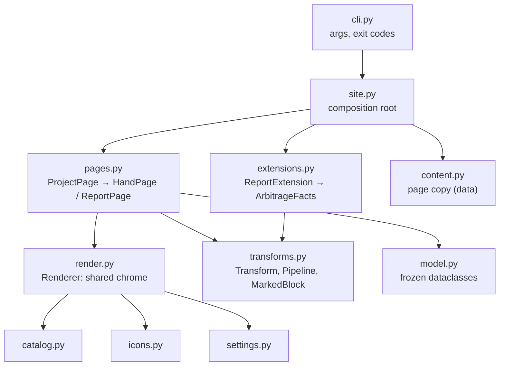

# Project pages

The seven write-ups under `/projects/<slug>/` are static HTML files produced by a Python generator, [`scripts/project_pages/`](../scripts/project_pages/). This doc covers using it, the R Markdown workflow, how it works, and how to extend it.

## Contents

- [Quick reference](#quick-reference)
- [Two kinds of page](#two-kinds-of-page)
- [Workflows](#workflows)
- [Page copy reference](#page-copy-reference)
- [What every page contains](#what-every-page-contains)
- [How report pages are enhanced](#how-report-pages-are-enhanced)
- [How the generator is built](#how-the-generator-is-built)
- [Extending the generator](#extending-the-generator)
- [Troubleshooting](#troubleshooting)

---

## Quick reference

```bash
python3 scripts/build-project-pages.py           # (re)build all project pages — safe to run any time
python3 scripts/build-project-pages.py --check   # change nothing; exit 1 if any page is out of date
```

- **Requirements:** Python ≥ 3.8, standard library only. Verified on 3.8, 3.9, 3.11 and 3.13.
- **Output** is committed to git. Nothing runs at deploy except `--check`, which **fails the deploy** if the committed pages don't match what the generator would produce. That catches forgotten regenerations ([decision D15](decisions.md#d15-generated-project-pages-are-committed-and-checked-in-ci)).
- **Never hand-edit** `public/projects/<slug>/index.html`. Edit the inputs and re-run.

| To change | Edit |
|---|---|
| Page wording, metrics, actions, jump links | [`scripts/project_pages/content.py`](../scripts/project_pages/content.py) |
| Titles, "Next project" teasers, page order | [`content/projects.json`](../content/projects.json) |
| Name/role/location in nav and footer | [`content/identity.json`](../content/identity.json) |
| URL, analytics ID, fonts | [`config/site.json`](../config/site.json) |
| Icons | [`content/icons.json`](../content/icons.json) |
| Colours | [`public/tokens.css`](../public/tokens.css) (no regeneration needed: it's loaded at runtime) |
| Layout of the shared chrome | [`render.py`](../scripts/project_pages/render.py) and [`public/projects/site.css`](../public/projects/site.css) |

---

## Two kinds of page

| | Hand pages | Report pages |
|---|---|---|
| Pages | `eildon-park-cricket-club`, `melbourne-pedestrian-counting`, `victorian-property-prices-dashboard` | `afl-brownlow-2025`, `afl-brownlow-2024`, `afl-brownlow-2023`, `h2h-arbitrage-finder` |
| Source | Copy in `HAND_PAGES` | R Markdown knitted to HTML (~2 MB, with jQuery, Bootstrap 3 and DataTables embedded) |
| The generator… | writes the whole page | wraps the existing knitr HTML in the shared chrome; **the report body is never modified** |
| Class | `HandPage` | `ReportPage` |

The reports stay as knitr output instead of being rewritten as React, because their data-heavy layouts are what R produces best and rewriting them adds risk for no benefit ([decision D02](decisions.md#d02-project-pages-are-static-html-not-react)).

---

## Workflows

### Edit a page's wording

1. Edit the page's entry in `content.py`.
2. `python3 scripts/build-project-pages.py`
3. Commit the copy change **and** the regenerated HTML.

### Update a report after re-knitting it

1. Knit the `.Rmd` and replace `public/projects/<slug>/index.html` with the fresh output.
2. `python3 scripts/build-project-pages.py`
3. Review the "At a glance" panel against the new results. For the arbitrage finder, the metrics and snapshot date are recomputed from the report's data automatically. For the Brownlow pages, the numbers are hand-written in `content.py`; update them if the model changed.

A freshly knitted report and an already-enhanced one produce **byte-identical** output, so this is always safe.

### Add a page

See [Editing content → Add a project](editing-content.md#add-a-project). In short: register it in `content/projects.json`, add its copy to `HAND_PAGES` or `REPORT_PAGES`, and run the generator. The generator refuses to run if `projects.json` lists a page that has no copy.

---

## Page copy reference

Each entry in `HAND_PAGES` / `REPORT_PAGES` is a dict, keyed by slug, that becomes an immutable `PageCopy` (see [`model.py`](../scripts/project_pages/model.py)). Values may contain inline HTML (for example `<strong>`).

| Key | Required | Meaning |
|---|---|---|
| `title` | no | Defaults to the title in `content/projects.json`. Leave it out, so the title has one source. |
| `description` | yes | Meta description and social-share text |
| `kicker` | yes | Small uppercase category line above the title |
| `lede` | yes | The one-paragraph summary under the title: lead with the result |
| `meta` | no | Mono line under the lede (e.g. "Trained on 2015–2023 · Tested on 2024"). For the arbitrage page it's computed. |
| `stack` | yes | List of tools, shown as chips |
| `actions` | yes | Header buttons; the first is primary. Each is `{"label", "href", "icon"}` plus optional `"download": True`. `http(s)` links open in a new tab automatically. `icon` must be a key in `content/icons.json`. |
| `glance.question` | yes | "The question" in the At a glance panel |
| `glance.did` | yes | "What I did" bullets |
| `glance.outcome` | no | An "Outcome" paragraph (full width) |
| `glance.metrics` | no | List of `(value, label)` tuples shown as metric tiles: use 3 or 4 |
| `glance.note` | no | Small print under the metrics, e.g. an evaluation caveat |
| `toc` | no | Jump links: `(label, anchor_id, is_key)` tuples; `is_key=True` highlights one (e.g. results) |
| `body` | hand pages | The article HTML. Use the `cd-` classes from `site.css` (`cd-figure`, `cd-gallery`, `cd-embed`, …). |
| `charts` | no | Hand pages only. `{id: {"title", "caption", "unit", "bars": [(label, value), …]}}`: a single-series bar chart, placed in `body` with `<!-- cd:chart:<id> -->`. See [Charts](#charts-in-hand-pages). |
| `galleries` | no | Hand pages only. `{id: {"title", "intro", "folder", "columns", "shots": [(name, alt, caption), …]}}`: a titled screenshot grid, placed in `body` with `<!-- cd:gallery:<id> -->`. See [Screenshot galleries](#screenshot-galleries). |

### Body building blocks

Hand-page bodies are plain HTML using these `site.css` classes (all token-coloured, mobile-first):

| Class | Use |
|---|---|
| `cd-figure`, `cd-gallery`, `cd-gallery--2` | Screenshots with captions; `--2` puts two side by side from 861px |
| `cd-embed`, `cd-embed-actions` | A Power BI iframe with a full-screen link |
| `cd-arch`, `cd-arch__lane`, `cd-arch__lane--core`, `cd-arch__nodes` | A system map: lanes stack with ↓ arrows on phones and sit in three columns with → arrows from 861px |
| `cd-cards`, `cd-cards--2`, `cd-card`, `cd-card__tag`, `cd-card__k` | Cards for decisions or problems; `--2` is two columns from 600px; `__k` is a small label such as "Why" |
| `cd-timeline`, `cd-timeline__when`, `cd-timeline__now` | A vertical timeline; `__now` fills the last dot |
| `cd-sr` | Visually hidden text for screen readers |
| `cd-tour`, `cd-gallery--3`, `cd-figure__zoom` | Rendered by the generator for `galleries` (don't hand-write them): a titled grid, three columns from 861px (two from 600px), and thumbnails that link to their full-size copy |

### Charts in hand pages

A chart is data in the page's `charts`, never hand-written markup:

```python
"charts": {
    "commits": {
        "title": "Commits by month (2026)",   # names the single series, so there's no legend
        "caption": "What the reader should notice, and any caveat (e.g. a part month).",
        "unit": "commits",                     # read after each value by screen readers
        "bars": [("Mar", 65), ("Apr", 15)],
    },
},
"body": """ … <!-- cd:chart:commits --> … """,
```

`Renderer.article()` swaps each slot for `Renderer.bar_chart()`: an ordered list with one accent-coloured bar per value, scaled to the largest, with every value printed above its bar, so the list is also the table view. It needs no JavaScript ([D21](decisions.md#d21-the-cricket-club-page-is-an-engineering-case-study)). A slot without a chart, or a chart without a slot, stops the generator with an error naming both.

### Screenshot galleries

A gallery is a titled grid of screenshots, also data rather than markup:

```python
"galleries": {
    "admin": {
        "title": "Admin portal",
        "intro": "One sentence on what the reader is looking at.",
        "folder": "tour",          # relative to the page's folder
        "columns": 2,              # 1, 2 or 3 on desktop
        "shots": [("admin-dashboard", "Alt text: what the screen shows", "Short caption.")],
    },
},
"body": """ … <!-- cd:gallery:admin --> … """,
```

Each shot is two WebP files next to the page:

| File | Width | Used for |
|---|---|---|
| `<folder>/<name>.webp` | At most 1656px (1 column), 820px (2 columns) or 540px (3 columns): twice its largest display width ([D04](decisions.md#d04-images-are-plain-img-self-hosted-webp)) | The lazy-loaded grid thumbnail |
| `<folder>/full/<name>.webp` | Any; optional | The full-size copy the thumbnail links to |

`Renderer.gallery()` reads each thumbnail's size from its WebP header (`images.py`, standard library only) for the `width` and `height` attributes, so the page doesn't jump as images load. It stops with an error if a thumbnail is missing or too wide for its column count. If the `full/` copy is missing, the thumbnail simply isn't a link.

**To add a screenshot:** save a PNG (desktop at 1440×900, phones at 390px wide and 2× scale), convert it to the two WebPs (for example with Pillow: resize to the thumbnail width and save at quality 76, and the full copy at quality 72), add a `(name, alt, caption)` tuple to the gallery, and run the generator. Captions describe the screen, never a live figure that will go stale ([D21](decisions.md#d21-the-cricket-club-page-is-an-engineering-case-study)).

---

## What every page contains

```
<head>   theme script (inline — runs before the body renders) · meta + Open Graph · fonts · /tokens.css · ../site.css (· ../report.css)
<body>
  skip link · nav (brand · ← Projects · Résumé · theme toggle)
  header      kicker · title · lede · meta · tool chips · action buttons
  At a glance question · what I did · outcome · metric tiles · note
  On this page jump links (if toc)
  …article body (hand page) or untouched knitr body (report)…
  Next project card (from the catalog order) · All projects · View résumé
  footer
```

The nav, the theme toggle and the theme script behave exactly as on the home page: they use the same [`lib/theme.js`](../lib/theme.js) and the same `[data-theme-toggle]` contract ([Design system → Themes](design-system.md#themes-light-and-dark)).

---

## How report pages are enhanced

`ReportPage` runs a `Pipeline` of small, single-purpose, idempotent `Transform`s over the knitr HTML, in this order:

| # | Transform | Effect |
|---|---|---|
| 0 | *extension transforms* | e.g. `RemoveUpdatedBullet` for the arbitrage page (the date moves into the header) |
| 1 | `SetTitle` | `<title>` becomes "Page title — Cooper Denny" |
| 2 | `RemoveLegacyHeadAssets` | Drops the old per-folder `rmd-styles.css`, old fonts link and Font Awesome |
| 3 | `UpsertBlock(head)` | Theme script, meta tags, fonts, `/tokens.css`, `../site.css`, `../report.css` |
| 4 | `SetBodyClass` | `<body class="cd-page cd-report">` |
| 5 | `RemoveLegacyChrome` | First run only: the old pasted-in nav and dataset download bar |
| 6 | `UpsertBlock(nav)` | The shared nav, straight after `<body>` |
| 7 | `UpsertBlock(header)` | Replaces pandoc's `<div id="header">` with the project header, At a glance panel and jump links |
| 8 | `FoldCodeChunks` | Every R chunk goes inside `<details>` ("R code"), so the narrative reads first |
| 9 | `FoldLongOutputs` | Printed output over 14 lines goes inside `<details>`, except output containing "Confusion Matrix" |
| 10 | `UpsertBlock(next)` | Next-project card and footer, before `</body>` |

**Idempotence.** Injected blocks sit between markers such as `<!-- cd:header -->` and `<!-- /cd:header -->`. `UpsertBlock` replaces the block if its markers exist, or inserts it on the first run. The fold transforms skip chunks that are already folded. That's why re-running is always safe, and why a fresh knit and a re-run converge on the same output.

**Computed facts.** `ArbitrageFacts` (a `ReportExtension`) reads the report's embedded DataTables JSON, groups outcomes into markets, and computes: markets scanned, sports covered, arbitrages found (combined book under 100%), best guaranteed return and the largest odds used. It also takes the snapshot date from knitr's "Updated as of" bullet, or on later runs from a `<!-- cd:snapshot YYYY-MM-DD -->` marker it leaves in the header.

---

## How the generator is built



| Module | Responsibility |
|---|---|
| `cli.py` | Parses `--check`, builds every page, prints what changed, sets the exit code |
| `site.py` | **Composition root.** Loads settings, catalog and icons, builds one page object per entry, and attaches extensions by slug |
| `pages.py` | `ProjectPage` (abstract: `render(current) -> html`, `build(write)`); `HandPage` renders a whole document; `ReportPage` composes the transform pipeline |
| `render.py` | `Renderer`: pure functions from copy to HTML fragments (head meta, fonts, analytics, theme script and toggle, nav, hero, summary, next-project card) |
| `transforms.py` | `Transform` ABC, `Pipeline`, `MarkedBlock`/`UpsertBlock`, and the single-purpose HTML edits |
| `extensions.py` | `ReportExtension` hook (`enrich`, `transforms`), DataTables reader, `ArbitrageFacts` |
| `model.py` | Immutable `PageCopy`, `Glance`, `Action`, `Metric`, `TocItem`, `BarChart`, `Gallery`, `Shot`; `PageCopy.from_dict` |
| `images.py` | `webp_size()`: a WebP's pixel size from its header, for gallery `width`/`height` and the thumbnail width check |
| `content.py` | The copy. Data only. |
| `catalog.py`, `icons.py`, `settings.py` | Read `content/projects.json`, `content/icons.json`, `config/site.json`, `content/identity.json`, `public/tokens.css` and `lib/theme.js` |

The design follows the same [rules](architecture.md#the-rules) as the React code: one source per fact, a composition root, one level of abstraction per method, and extension without modification.

---

## Extending the generator

### Add a transform (all report pages)

1. Subclass `Transform` in `transforms.py`, with one job and an idempotent `apply(src) -> src`: running it twice must equal running it once.
2. Add it to the list in `ReportPage._pipeline()`.
3. Run the generator twice; the second run must report "all project pages up to date".

### Add page-specific behaviour (one report)

Don't add `if slug == …` to `ReportPage`. Instead:

1. Subclass `ReportExtension` in `extensions.py`. Override `enrich(copy, src)` to return the copy with computed fields (use `copy.with_results(...)`), and/or `transforms()` to add extra transforms.
2. Register it in `EXTENSIONS` in `site.py`, keyed by slug.

### Change the shared chrome

Edit the relevant `Renderer` method in `render.py`, and its styles in `public/projects/site.css`. Every page picks it up on the next run. If the nav or theme toggle changes, keep it consistent with `components/layout/` on the home page.

---

## Troubleshooting

| Message | Cause | Fix |
|---|---|---|
| `would change: <slugs>` (exit 1, from `--check`) | Committed pages don't match the inputs | Run `python3 scripts/build-project-pages.py` and commit the result |
| `in content/projects.json but no page copy: [...]` | A page is registered but has no entry in `HAND_PAGES` / `REPORT_PAGES` | Add its copy, or remove it from `projects.json` |
| `KeyError: "'<slug>' is not in content/projects.json"` | Page copy exists for a slug that isn't registered | Add it to `projects.json` |
| `…/index.html: knit the report from its .Rmd first` | A report page has no HTML yet | Knit it into `public/projects/<slug>/index.html` |
| `couldn't find pandoc's #header block to replace` | A freshly knitted report has no `<div id="header">`, e.g. the `.Rmd` has no `title:` | Give the R Markdown a title in its YAML header and re-knit |
| `arbitrage report: expected the H2H and back/lay result tables — has the report changed?` | The arbitrage report no longer has two DataTables with `market` and `converted_odds` columns | Restore those tables in the `.Rmd`, or update `ArbitrageFacts` |
| `<slug>: chart slots without a chart [...], charts without a slot [...]` | A `<!-- cd:chart:<id> -->` in `body` doesn't match a key in `charts`, or the reverse | Fix the id, or add the missing slot or chart |
| `<slug>: gallery slots without a gallery [...], galleries without a slot [...]` | The same mismatch for `<!-- cd:gallery:<id> -->` and `galleries` | Fix the id, or add the missing slot or gallery |
| `<slug>: gallery '<id>' needs <folder>/<name>.webp` | A shot's thumbnail isn't on disk | Add the WebP, or fix the shot's name |
| `<slug>: <file> is <n>px wide; a <c>-column gallery allows <max>px` | The thumbnail is more than twice its display width | Re-save it at the allowed width (the full-size copy can stay large) |
| `design token --band not found in …tokens.css` | `--band` was renamed or removed | Restore it; it sets the browser theme colour |
